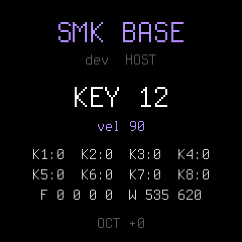

# SMK BASE

**The smallest firmware for the M-Vave SMK-37 to build your own on.** It plays a sine wave on the keys and the pads,
shows on the screen which control you touched last, and does nothing else. Under it is everything an SMK-37 firmware
needs before it can be any fun: the update path, the USB rescue, USB MIDI and USB audio, the keys with velocity, the
pads with their colours, the eight encoders, faders, wheels and button LEDs, the screen, flash storage. Each of them is
used once in [firmware/src/app.c](firmware/src/app.c), as an example and as a check on a unit.

<p align="center">

</p>

It is [Dinghy](https://github.com/zvenson/dinghy) (zvenson) for the SMK-37 only, on Felucca's and SLOOP's platform and
genkigenki's SMK-37 layer, with the pads tuned on a unit and the controls on the screen. What changed from Dinghy:
[docs/CHANGES.md](docs/CHANGES.md).

> **Status.** SMK-37 Pro: installed and checked on one unit on 2026-11-03 (every control, sound, the screen). Not
> tried yet: the SMK-37 Elite and MKE-P37 packages. Installing firmware is at your own risk: back up the
> flash first.

## What it does

| Control | |
| --- | --- |
| keys | a sine, 4 voices, with the key's velocity; the note goes out over USB-MIDI on channel 1 |
| pads | the same: the bottom row the white keys 1-8 from F3, the top row 9-16; a pad glows while its note sounds |
| OCTAVE- / OCTAVE+ | the octave, -2..+2, kept in flash |
| K1 | the volume |
| pitch wheel | bends +-2 semitones |
| buttons | lit while held |
| MIDI in (USB) | notes on any channel play the sine |
| screen | the last control touched by its hardware id (keys 0-36, buttons 0-17, pads 0-15, faders 0-3, wheels 0-1; encoders K1-K8), the encoders' positions, the faders, the wheels |

## Start your own

1. Copy this folder (or `git clone` it) under a new name.
2. Change `firmware/src/app.c`: `app_audio()` is the sound (the audio interrupt: short, no flash, no screen),
   `app_main()` the main loop (controls, MIDI, screen, saving). What the platform offers: [docs/API.md](docs/API.md);
   the chip's rules (no FPU, no 64-bit division, the interrupt's budget): [docs/RULES.md](docs/RULES.md).
3. Give it its own name, data and identity, so it never takes another firmware's data or looks like it to the
   installers and the [Firmware Hub](https://thefirmwarehub.com):
   - `APP_NAME` and `STORE_MAGIC` at the top of `app.c`;
   - `DATA_FAMILY`, `IDENT` (a `9NN` no other firmware uses: look at the hub) and the package name in
     `tools/build.py`;
   - the package names in `.github/workflows/release.yml`.

`platform.c`, `firmware/hal/` and `firmware/loader/` you should not need to touch.

A release: `./build.sh --release 0.2` puts the version on the screen (`build/smk37-base-0.2.fwsc`); pushing a tag
`v0.2` to GitHub builds the three packages, runs the tests and publishes them.

## Build and test

Linux on x86-64, or macOS / Windows with Docker (Podman works as `docker`), Python 3 with Pillow, JieLi's toolchain and
three files of the JieLi AC79 SDK:

```sh
tools/get_toolchain.sh                      # JieLi's clang for the chip, to ~/.jieli/toolchain
git clone --depth 1 --branch AC79NN_SDK_V1.2.1_2023-12-13 \
    https://gitee.com/Jieli-Tech/fw-AC79_AIoT_SDK.git ~/fw-AC79_AIoT_SDK
./build.sh                                  # -> build/smk37-base.fwsc (it refuses what would brick the instrument)
./build.sh --model elite                    # the same for the SMK-37 Elite (--model mke: the MKE-P37)
```

On a computer, without the instrument:

```sh
tests/run_host.sh tests/scripts/diag.txt    # the app: screens as PNG, the sound as WAV, in build/host/
sh tests/run_tests.sh                       # the whole suite, after ./build.sh
```

## Install

Python 3 with `pip3 install mido python-rtmidi`, the SMK-37 on USB, no other app on its MIDI port.

1. **Back up the flash** first: [docs/BACKUP.md](docs/BACKUP.md). It writes nothing.
2. **Install**, from the stock firmware or another firmware of the family (the installer checks the model):

   ```sh
   python3 tools/fm1_install.py --info                       # what runs now
   python3 tools/fm1_install.py build/smk37-base.fwsc --yes  # identity SMK-37 Pro_925
   ```

3. **The first start clears the store** when another firmware's data is there (the stock settings, or another
   firmware's): the settings and blobs from 0x9D000, the slots' first sectors from 0xC2000, the owner tag at
   0xAF000 ([store.h](firmware/src/store.h)). Your backup has them.

**If it goes wrong:** cut off during the write, power-cycle and run the install again (the loader resumes). If it does
not start, it opens a USB rescue after two failed starts; hold **OCTAVE-** while switching on to get there yourself,
and install a working package from it. The mask-ROM bootloader (docs/BACKUP.md) is always there below.

## License

GPL-3.0-only, as Dinghy, Felucca and SLOOP: you may change and share it, and whoever gets your firmware gets its
source. Who made what and the third-party parts: [LICENSING.md](LICENSING.md).
